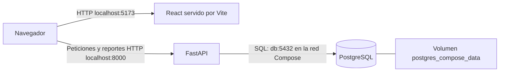

# SistemaINC 1.0 — Sistema de Gestión de Incidencias

Aplicación web para registrar, consultar y dar seguimiento a incidencias de una
organización. Centraliza la descripción de los problemas, su categoría, prioridad
y estado, y permite analizar la actividad mediante estadísticas y reportes.

La versión 1.0 reúne una API REST con PostgreSQL y una interfaz React. La
configuración incluida está orientada a **desarrollo y demostración local**.

## 1. Tecnologías

| Componente | Tecnología verificada | Función |
|---|---|---|
| Backend | Python 3.14; FastAPI 0.142.2 | API REST y validación de peticiones |
| Modelos | Pydantic 2.13.5 | Esquemas y validaciones |
| Base de datos | PostgreSQL 18.6 en Compose | Persistencia de incidencias |
| Conexión | Psycopg 3.3.6, extra `binary` | Consultas SQL y transacciones |
| Servidor | Uvicorn 0.54.0 | Ejecución de FastAPI |
| Configuración | python-dotenv 1.2.4 | Carga de variables locales |
| Excel | OpenPyXL 3.1.5 | Generación de archivos XLSX |
| Frontend | React 19.3.1; Vite 8.3.4 | Interfaz y herramientas de desarrollo |
| Gráficos e iconos | Recharts 3.10.1; lucide-react 1.57.0 | Visualizaciones y controles |
| Pruebas backend | pytest 9.1.1; pytest-cov 7.1.0; HTTPX2 2.13.1 | API, integración y cobertura |
| Pruebas frontend | Vitest 5.1.0; React Testing Library 16.3.3 | Interacciones de la interfaz |
| Contenedores | Docker Compose; imágenes Python 3.14 y Node 24 | Ejecución local de los servicios |

Las versiones frontend indicadas proceden de `frontend/package-lock.json`;
`package.json` declara rangos. Las dependencias Python directas están fijadas
en `requirements.txt` y las de pruebas en `requirements-dev.txt`.

## 2. Funcionalidades

### Gestión de incidencias

- Creación con título, categoría, descripción y prioridad.
- Consulta de detalles, edición y eliminación con confirmación en la interfaz.
- Ciclo de atención: `Pendiente → En progreso → Resuelta`.
- Registro de creación y resolución. La categoría se conserva al editar.
- Respuestas 404 para incidencias inexistentes y 409 para transiciones rechazadas.

Categorías: **Informática (TI)**, **Mantenimiento e instalaciones**, **Seguridad**,
**Administración**, **Operaciones y logística** y **Otros**.
Prioridades: **Alta**, **Media** y **Baja**.

El título es obligatorio, se recortan sus espacios exteriores y admite hasta
200 caracteres. La descripción también es obligatoria y no puede quedar vacía.
La API valida categoría y prioridad mediante enumerados; normaliza espacios y
capitalización de la prioridad. El frontend limita la descripción a 2000
caracteres; ese límite no está declarado en el esquema del backend.

### Búsqueda, filtros y tabla

- Búsqueda por título o ID mediante un selector de modo.
- Chips combinables de categoría, prioridad y estado, con limpieza de filtros.
- Ordenamiento por ID, prioridad, estado y fecha de creación.
- Paginación en React de **20 incidencias**, calculada sobre los resultados
  filtrados. Cambiar búsqueda, filtros u orden reinicia la página.
- Por defecto se conserva el orden del backend: no resueltas primero, prioridad
  Alta/Media/Baja y fecha de creación ascendente.

### Exportación

CSV y Excel exportan los resultados correspondientes a prioridad, estado,
categoría y búsqueda por título, independientemente de la página de la tabla.
La exportación se deshabilita con una búsqueda por ID activa, durante la carga,
ante un error o si no hay coincidencias.

Excel identifica las fechas como `America/Santiago`. CSV incluye BOM UTF-8 y
serializa las fechas recibidas del backend; no aplica la conversión local de
Excel. El contenido de usuario se protege frente a interpretación como fórmula.

## 3. Arquitectura



El JavaScript se ejecuta en el navegador y consulta `http://127.0.0.1:8000`.
No debe usar `http://api:8000`: ese nombre solo existe en la red Docker.
FastAPI sí utiliza el nombre interno `db` para conectarse a PostgreSQL.

API y frontend publican sus puertos únicamente en `127.0.0.1`. El servicio `db`
no publica 5432 al host. CORS admite `http://localhost:5173` y
`http://127.0.0.1:5173`.

## 4. Estructura del proyecto

```text
sistema-incidencias/
├── app/
│   ├── main.py                    # Endpoints y exportaciones
│   ├── crud.py                    # SQL y transacciones
│   └── schemas.py                 # Modelos, categorías, prioridades y estados
├── frontend/
│   ├── public/favicon.svg
│   ├── src/
│   │   ├── App.jsx
│   │   ├── App.css
│   │   ├── App.test.jsx
│   │   ├── index.css
│   │   ├── main.jsx
│   │   └── setupTests.js
│   ├── index.html
│   ├── package.json
│   ├── package-lock.json
│   ├── vite.config.js
│   ├── eslint.config.js
│   ├── Dockerfile
│   ├── .dockerignore
│   └── .gitignore
├── docker/postgres/init/001_incidencias.sql
├── scripts/
│   ├── seed_incidencias.py
│   └── migrations/001_seed_lotes.sql
├── tests/
│   ├── test_main.py
│   ├── test_integracion.py
│   ├── test_seed_incidencias.py
│   └── test_export_timezone.py
├── conexion.py
├── compose.yaml
├── Dockerfile
├── .dockerignore
├── .gitignore
├── .env.example
├── requirements.txt
├── requirements-dev.txt
└── README.md
```

`app/` contiene el backend; `frontend/`, la aplicación y sus pruebas;
`tests/`, las pruebas Python; `docker/`, la inicialización de bases nuevas;
`scripts/`, las herramientas opcionales de demostración.

## 5. Requisitos previos

**Con Compose:** Git y Docker Desktop con integración WSL, o Docker Engine con
el plugin Compose. No es necesario instalar Python, Node o PostgreSQL en el host
para ejecutar los tres servicios.

**Sin Docker:** Python 3.14 con soporte para `venv`, Node.js 24 y npm,
PostgreSQL 18 y, para los comandos SQL siguientes, el cliente `psql`.
Los ejemplos de terminal usan Bash en Linux/Ubuntu WSL.

## 6. Instalación con Docker Compose

### Clonar y configurar

```bash
git clone https://github.com/JavierNT1/Sistema-gestion-incidencias.git sistema-incidencias
cd sistema-incidencias
cp -n .env.example .env
```

Edita `.env` y reemplaza la contraseña ficticia por una propia antes de iniciar.
Si ya tienes `.env`, conserva sus valores y no lo sobrescribas.

### Construir e iniciar

```bash
docker compose config --quiet
docker compose up -d --build
docker compose ps
```

Servicios: `db` (PostgreSQL), `api` (FastAPI) y `frontend` (Vite). La API espera
el healthcheck de PostgreSQL. El frontend depende del arranque de la API, pero
no existe un healthcheck de disponibilidad HTTP para esta última.

En un volumen vacío, PostgreSQL ejecuta automáticamente
`docker/postgres/init/001_incidencias.sql` y crea la tabla completa.
**La instalación comienza con cero incidencias.** Un volumen ya inicializado
no vuelve a ejecutar ese SQL; no se migra ni reemplaza su contenido.

### Acceder y consultar registros

- [Interfaz](http://127.0.0.1:5173/)
- [API](http://127.0.0.1:8000/)
- [Swagger UI](http://127.0.0.1:8000/docs)
- [OpenAPI JSON](http://127.0.0.1:8000/openapi.json)

```bash
docker compose logs --tail=100 api frontend db
```

Revisa y oculta información sensible antes de compartir registros.

### Detener y volver a iniciar

```bash
docker compose stop
docker compose start
```

Para retirar los contenedores conservando los datos:

```bash
docker compose down
# Para crearlos de nuevo con el volumen conservado:
docker compose up -d
```

**No utilices `docker compose down -v` como procedimiento habitual:** elimina
los volúmenes y puede destruir los datos persistentes.

## 7. Variables de entorno

| Variable | Ejecución local desde `.env` | API en Compose |
|---|---|---|
| `DB_HOST` | Host PostgreSQL, por ejemplo `localhost` | `db`, fijado por Compose |
| `DB_PORT` | Puerto PostgreSQL, por ejemplo `5432` | `5432`, fijado por Compose |
| `DB_NAME` | `incidencias_db` | `incidencias_db`, fijado por Compose |
| `DB_USER` | Usuario PostgreSQL configurado | Interpolado desde `.env` |
| `DB_PASSWORD` | Contraseña propia | Interpolada desde `.env` |

En `db`, Compose transforma las credenciales en `POSTGRES_USER` y
`POSTGRES_PASSWORD`, y fija `POSTGRES_DB=incidencias_db`. Estas variables
inicializan un volumen nuevo: cambiar `.env` no cambia automáticamente las
credenciales de un volumen existente.

`conexion.py` carga `.env` mediante python-dotenv. Las variables ya definidas en
el entorno, incluidas las de Compose, tienen precedencia. No publiques `.env`;
Git y las construcciones Docker lo excluyen.

## 8. Ejecución local sin Docker

### PostgreSQL

Necesitas un servidor accesible desde Ubuntu. Crea `incidencias_db` con un
usuario autorizado y prepara **solo una base nueva y vacía**:

```bash
createdb -h localhost -U sistemainc_local incidencias_db
psql -h localhost -U sistemainc_local -d incidencias_db -v ON_ERROR_STOP=1 \
  -f docker/postgres/init/001_incidencias.sql
```

Sustituye `sistemainc_local` por el usuario que hayas configurado. Los comandos
pueden solicitar contraseña; no la incluyas en el historial de terminal.
No ejecutes la inicialización sobre una tabla ya existente ni borres datos para
aplicarla. Las actualizaciones de bases antiguas requieren revisión específica.

### Backend

Desde la raíz, configura `.env` para ese servidor y ejecuta:

```bash
python3.14 -m venv .venv
source .venv/bin/activate
python -m pip install -r requirements.txt
uvicorn app.main:app --host 127.0.0.1 --port 8000 --reload
```

### Frontend, en otra terminal

```bash
cd frontend
npm ci
npm run dev -- --host 127.0.0.1
```

Libera los puertos 8000/5173 antes de usar ejecución local si Compose ya los
ocupa. El PostgreSQL de Compose no es accesible desde `localhost:5432` porque
su puerto no está publicado.

## 9. API REST

| Método | Ruta | Comportamiento |
|---|---|---|
| GET | `/` | Mensaje de bienvenida |
| GET | `/incidencias` | Listado; filtros opcionales `prioridad`, `estado`, `categoria`, `titulo` |
| GET | `/incidencias/{id}` | Detalle; 404 si no existe |
| POST | `/incidencias` | Crea una incidencia; respuesta 201 |
| PUT | `/incidencias/{id}` | Actualiza título, descripción y prioridad; conserva categoría |
| DELETE | `/incidencias/{id}` | Elimina y devuelve la incidencia; 404 si no existe |
| POST | `/incidencias/{id}/iniciar` | Pendiente a En progreso; 404 o 409 según el caso |
| POST | `/incidencias/{id}/resolver` | En progreso a Resuelta; registra fecha de resolución |
| GET | `/incidencias/exportar/csv` | Reporte CSV; mismos filtros del listado |
| GET | `/incidencias/exportar/excel` | Reporte XLSX; mismos filtros del listado |

Los filtros de texto del backend buscan coincidencias parciales del título sin
distinguir mayúsculas. Las entradas inválidas producen respuestas 422.
`/docs` permite explorar y ejecutar las operaciones descritas por OpenAPI.

Ejemplo de cuerpo para crear una incidencia:

```json
{
  "titulo": "Impresora sin conexión en recepción",
  "categoria": "Informática (TI)",
  "descripcion": "Los trabajos permanecen en cola y el equipo no responde por la red.",
  "prioridad": "Media"
}
```

El esquema actual exige esos cuatro campos también en PUT, aunque la categoría
enviada no modifica la almacenada. La interfaz envía la categoría existente.

## 10. Estadísticas

Los indicadores se calculan en React a partir del listado completo, sin limitarse
a la página visible ni a los filtros de la tabla:

- Total y contadores por prioridad y estado.
- Gráficos de distribución por estado, prioridad y categoría.
- Tiempo promedio de resolución en horas: diferencia entre resolución y
  creación, considerando incidencias resueltas con ambas fechas y duración
  finita no negativa.
- Histograma: `[0,12)`, `[12,24)`, `[24,48)`, `[48,72]` y más de 72 horas.
- Evolución mensual de creadas y resueltas por los períodos **1–7, 8–14,
  15–21, 22–28 y 29–último día**. El último se omite si no existe, como en
  febrero de 28 días.

El gráfico mensual utiliza `America/Santiago`. Cuenta las creaciones por
`fecha_creacion` y las resoluciones por `fecha_resolucion`, por lo que una
incidencia puede crearse en un mes y resolverse en otro.

## 11. Pruebas automatizadas

### Backend

Desde la raíz y con el entorno virtual activo:

```bash
python -m pip install -r requirements-dev.txt
python -m pytest tests/ -q --tb=short
python -m pytest tests/ --cov=app --cov-branch --cov-report=term-missing
```

En la revisión documental se descubrieron **74 casos backend**. Incluyen API,
exportaciones, zona horaria, generador y operaciones reales de PostgreSQL.
El recuento de colección no significa que la suite haya pasado en esa ejecución.

Las pruebas de integración utilizan `obtener_conexion_pruebas()`, cuyo nombre de
base está fijado a **`incidencias_test`**, y sustituyen la conexión del CRUD.
Crean datos propios y los revierten o eliminan mediante limpieza en `finally`.
No cambies esa conexión para apuntar a `incidencias_db`.

La base de pruebas y su esquema deben existir previamente en el servidor
configurado por `DB_HOST`, `DB_PORT`, `DB_USER` y `DB_PASSWORD`. Para una base
de pruebas nueva y vacía, usando el usuario adecuado:

```bash
createdb -h localhost -U sistemainc_local incidencias_test
psql -h localhost -U sistemainc_local -d incidencias_test -v ON_ERROR_STOP=1 \
  -f docker/postgres/init/001_incidencias.sql
```

**Dos entornos distintos:** la aplicación de Compose usa su servicio `db`;
pytest ejecutado desde Ubuntu usa el servidor indicado en `.env`. En el entorno
original, este último es el contenedor independiente `postgres-incidencias`.
Si se conserva ese contenedor, `docker start postgres-incidencias` lo inicia.
No es un servicio de Compose ni se crea automáticamente al clonar el proyecto.
Un servidor PostgreSQL local equivalente también sirve para las pruebas.

Si aparece `Connection refused` en `localhost:5432`, verifica que el servidor
de pruebas esté activo. Encender solo Compose no habilita ese puerto.

### Frontend

```bash
cd frontend
npm ci
npm run test:run
npm run lint
npm run build
```

`src/App.test.jsx` contiene **13 casos**: búsquedas, filtros, ordenamiento,
paginación, accesibilidad del modal y respuestas fuera de orden. Utiliza fetch
simulado, sin PostgreSQL. `npm run test` permite mantener Vitest en modo vigilancia.
El build genera `frontend/dist`; Compose actualmente sirve Vite en desarrollo,
no ese directorio como un sitio de producción.

## 12. Capturas de pantalla

No se incluyen capturas en el repositorio actual. Para documentar visualmente la
versión, agrega archivos reales del panel principal, tabla, estadísticas y
formulario en una carpeta como `docs/capturas/` y enlázalos después desde aquí.
No se incluyen enlaces de imagen hasta que esos archivos existan.

## 13. Persistencia y datos de demostración

El volumen `postgres_compose_data` mantiene la base al detener o recrear los
contenedores. PostgreSQL 18 lo monta en `/var/lib/postgresql`. El contenedor
anterior `postgres-incidencias` utiliza su propio almacenamiento y no debe
eliminarse para administrar Compose.

Los datos restaurados del entorno del autor no se incluyen automáticamente.
El generador mensual opcional utiliza `conexion.py` y admite exclusivamente
`incidencias_db`. Antes de cargar, revisa el destino: el nombre de base no
distingue por sí solo dos servidores distintos con el mismo nombre.

Para usarlo, las tablas auxiliares se preparan una sola vez, mediante aplicación
manual autorizada de [001_seed_lotes.sql](scripts/migrations/001_seed_lotes.sql).
El script no ejecuta la migración automáticamente. No la apliques a producción
ni repitas su ejecución sobre tablas ya existentes.

Simulación, desde la raíz y con `.venv` activo:

```bash
python scripts/seed_incidencias.py \
  --database incidencias_db --month 2026-09 --count 100 --seed 42
```

Carga real, únicamente tras revisar el resumen y autorizarla:

```bash
python scripts/seed_incidencias.py \
  --database incidencias_db --month 2026-09 --count 100 --seed 42 --apply
```

Solicita la frase `CARGAR incidencias_db 2026-09 100`. Agrega un lote de 100
registros: no completa un total global de 100. Conserva incidencias anteriores.
Cada mes admite un lote; repetir los mismos parámetros no duplica datos y
cambiar cantidad, semilla o versión para un mes cargado produce conflicto.

Las fechas respetan Chile y no se generan en el futuro. Para el mes actual,
se distribuyen únicamente hasta el momento de ejecución; los resultados pueden
variar con ese momento aunque la semilla sea la misma. Los títulos pueden
repetirse como problemas recurrentes; la identidad del lote y sus claves
estables controlan los duplicados.

La API Docker contiene solo el backend de ejecución: el generador y las pruebas
se ejecutan desde el repositorio, con una conexión accesible y correctamente
configurada, no mediante `docker compose exec api`.

## 14. Limitaciones actuales

- No existe autenticación ni control de permisos por usuario. Uso local, con
  puertos ligados a localhost; no exponer directamente como servicio público.
- La URL de FastAPI está fijada en el frontend a `127.0.0.1:8000`; el navegador
  debe ejecutarse en el mismo PC. No hay configuración de despliegue remoto.
- Paginación y estadísticas se calculan en React sobre listados completos.
- La inicialización SQL es para bases nuevas: no es una migración incremental.
- Las dependencias Python transitivas y las etiquetas de imágenes no están
  bloqueadas completamente. `npm ci` sí utiliza el lockfile frontend.
- El build advierte sobre un paquete JavaScript superior a 500 kB; no impide
  compilar, pero puede afectar los tiempos de descarga.
- Las pruebas con mocks no sustituyen una validación visual completa ni una
  prueba de carga o concurrencia real de todo el sistema.